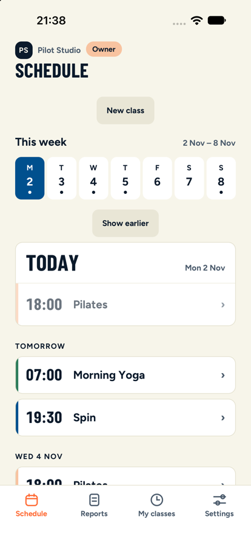
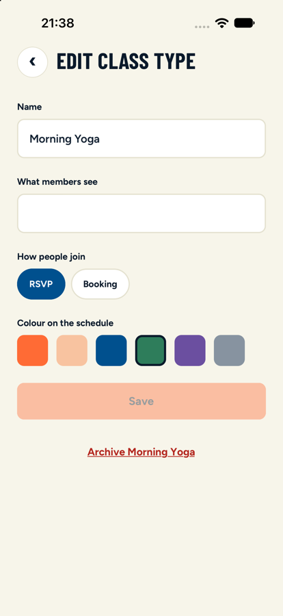
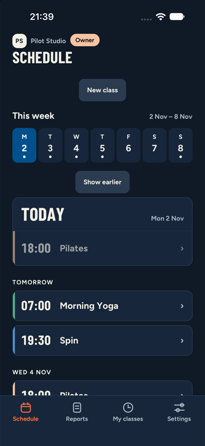
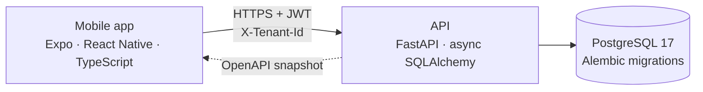

# Aretigo

### Excellence in Motion

Studio management, scheduling, memberships, attendance and athlete progression for coach-led studios, in one mobile app.

> **Showcase repository.** This repo presents the product, its architecture and the engineering decisions behind it. The application source code is private and is not published here.

---

## What it is

Aretigo is built for small, coach-led studios: pilates, yoga, BJJ, MMA, CrossFit, dance. The name joins *areté* (ἀρετή), the Greek idea of excellence and reaching one's full potential, with *go*, for movement.

Its core idea: **several coaches build one shared history of each participant**: attendance, feedback, notes and development, so the person is coached as a whole and not class by class.

  
  
  

## Features

| For owners | For coaches | For members |
|---|---|---|
| Studio, staff and class types with colours and descriptions | Weekly series and one-off classes | See the week at a glance, colour-coded by class type |
| Optional **booking** module: seat limits and a fair waitlist | Attendance and a post-class report | RSVP with one tap, or book a seat |
| Everything scoped to the studio, per role | Private, per-participant coaching notes | Read the class summary, confirm attendance |
| Account and data deletion | Notes can be shared with the member, per note | Light and dark mode, English and Hebrew-ready |

## Architecture at a glance

- **One API, one source of truth.** The app never touches the database; every rule (tenant, role, module) is enforced server-side.
- **Multi-tenant by construction.** One shared database, a `tenant_id` on every studio-owned row, and a single dependency that turns a request into a verified `(user, studio, role)`.
- **Typed end to end.** The API publishes an OpenAPI schema; the app's TypeScript types are generated from it, and CI fails if they drift.
- **Safe under concurrency.** Seat booking and refresh-token rotation are race-tested against a real Postgres.

Read more: **[Architecture](docs/architecture.md)** · **[Decision records](docs/decisions/)** · **[Code excerpts](docs/excerpts/)**

## Engineering at a glance

| | |
|---|---|
| Backend | Python 3.12+, FastAPI, SQLAlchemy 2 (async), Alembic, argon2, PyJWT, `uv`, `ruff` |
| Mobile | Expo Router, React Native, TypeScript (strict), generated API client |
| Data | PostgreSQL 17, 34 reviewed migrations, constraints over application checks |
| Quality | 690+ API tests on a real Postgres, 230+ app tests, typecheck and lint on every push |
| Delivery | Short-lived branches, squash-merged through CI; `master` is always green |

## Decisions worth reading

1. [Tenant isolation: one dependency, every query scoped](docs/decisions/001-tenant-isolation.md)
2. [Our own auth: JWT access tokens and rotating refresh tokens](docs/decisions/002-auth-and-refresh-rotation.md)
3. [Booking under load: row locks, not optimistic retries](docs/decisions/003-booking-concurrency.md)
4. [Optional modules per studio](docs/decisions/004-modules.md)
5. [API contract as a checked-in snapshot](docs/decisions/005-openapi-contract.md)
6. [Roles that stack, stored as data](docs/decisions/006-roles.md)

---

© Gal Havshush. All rights reserved. Showcase only: see [LICENSE](LICENSE). · [GitHub profile](https://github.com/GalHavshush)
