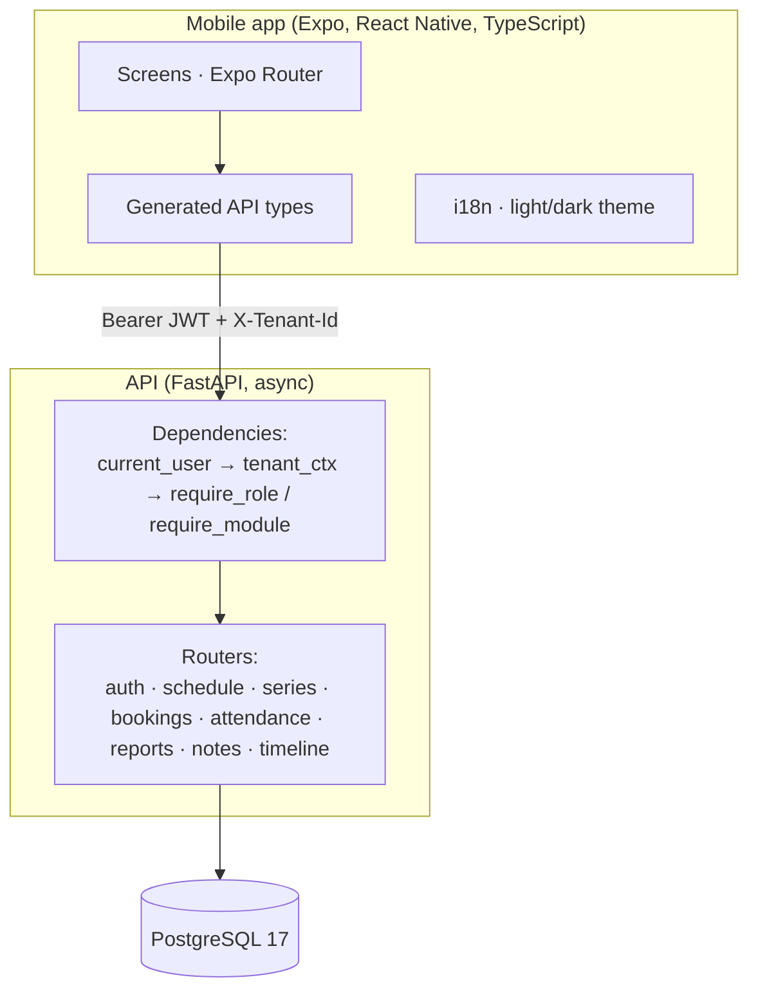
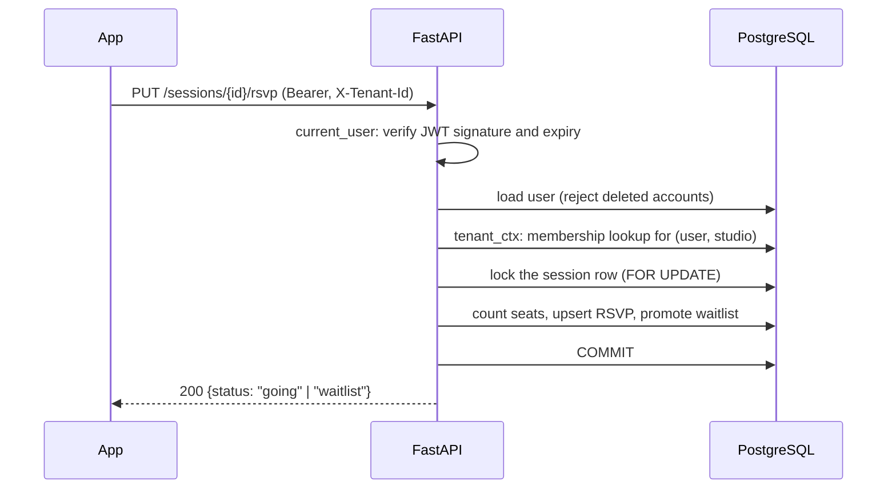
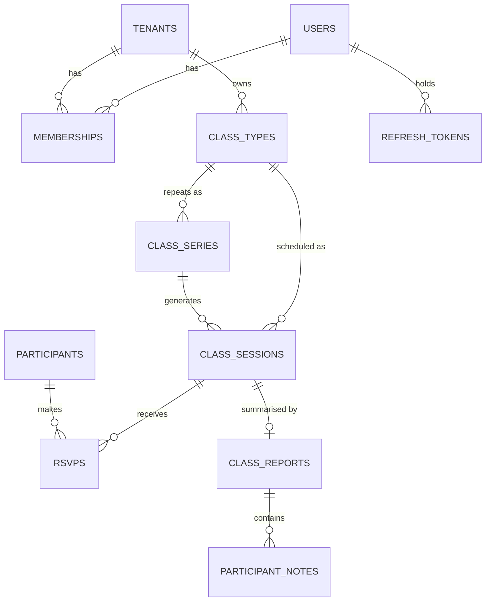
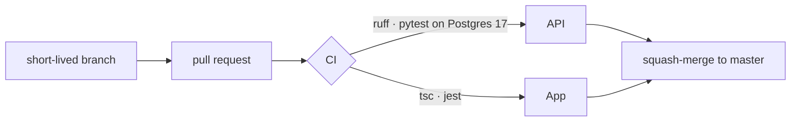

# Architecture

## System

Three rules shape everything else:

1. **The API is the only application surface.** The database has no public endpoint and the client holds no database credentials. Authorization lives in one place, in Python, where it is unit-tested.
2. **Identity is global, access is per studio.** A person has one account and any number of memberships. Every request names a studio; the server checks the membership.
3. **Constraints beat conventions.** Whatever the database can enforce (roles, positive capacities, uniqueness, same-studio links) it enforces, so a bug in a handler cannot corrupt data.

## Request flow

Failure order is deliberate and stable: `401` (who are you) → `400` (which studio) → `403` (not your studio, or role too low) → `404` (resource, scoped to your studio) → `409` (state conflict). Clients can rely on it.

## Data model

- Every studio-owned table carries `tenant_id`.
- Child tables reference their parents through **composite keys `(tenant_id, id)`**, so the database refuses a row that links two different studios. See [ADR 001](decisions/001-tenant-isolation.md).
- Times are stored as UTC instants; a studio's IANA timezone is returned with it and the client formats.
- The API returns **codes, not sentences** (`class_type_name_taken`); wording and language belong to the client.

## Security model

| Concern | Approach |
|---|---|
| Passwords | argon2 hashes only |
| Access | HS256 JWT, 15 minutes, carries only the user id |
| Sessions | Opaque refresh tokens, 30 days, stored as SHA-256 hashes, rotated on every use, revoked as a family when reuse is detected ([ADR 002](decisions/002-auth-and-refresh-rotation.md)) |
| Roles | Not in the token: read from the membership on each request, so removing someone takes effect on their next call |
| Probing | A studio that does not exist and a studio you are not in both return `403 not_a_member` |
| Deletion | Deleting an account revokes every device at once and rejects its still-valid access tokens immediately |

## Concurrency

Two places where two requests can collide, both covered by tests that run real concurrent transactions against Postgres:

- **Seat booking**: serialised with a row lock on the session ([ADR 003](decisions/003-booking-concurrency.md)).
- **Refresh rotation**: one `UPDATE … RETURNING` claims a token, so only one of two simultaneous refreshes can win.

## Delivery

- `master` is always releasable; there is no long-lived staging branch.
- Migrations are tested in CI: upgrade to head, downgrade to base, upgrade again, plus data-backfill cases.
- The OpenAPI document is committed; a test fails when the API changes without regenerating it ([ADR 005](decisions/005-openapi-contract.md)).
